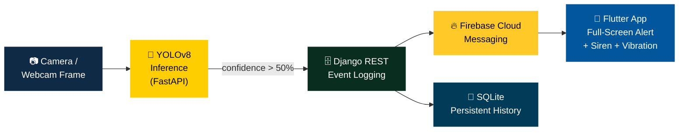
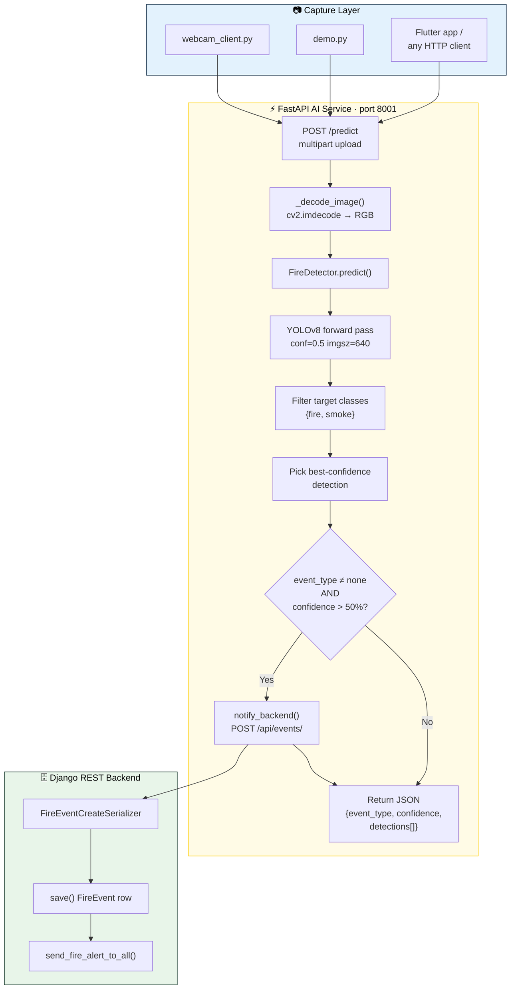
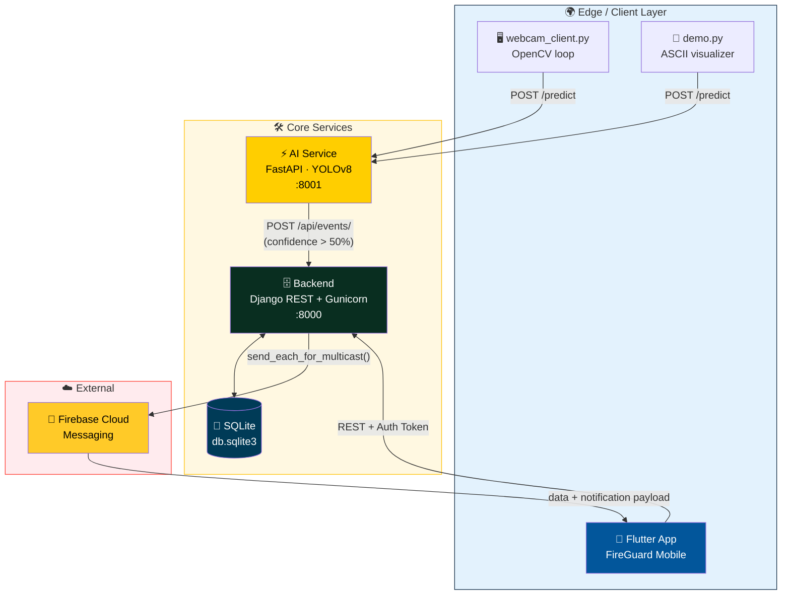
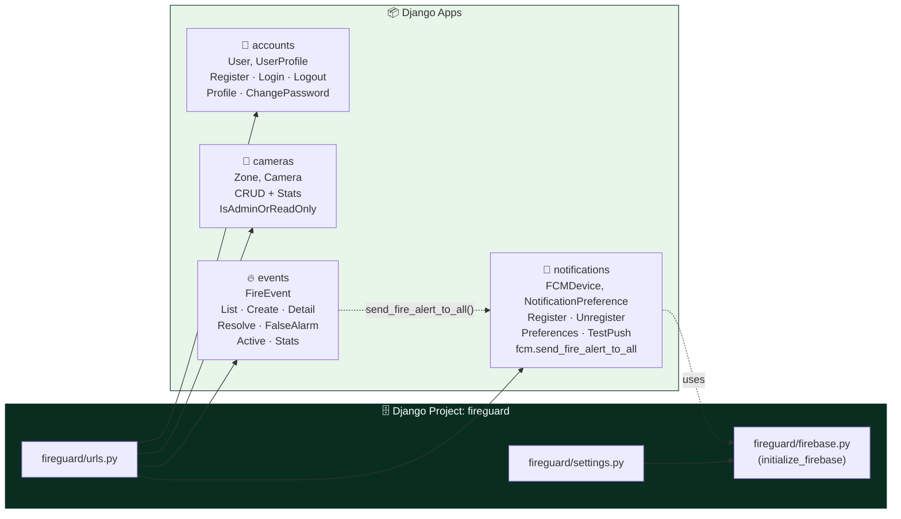
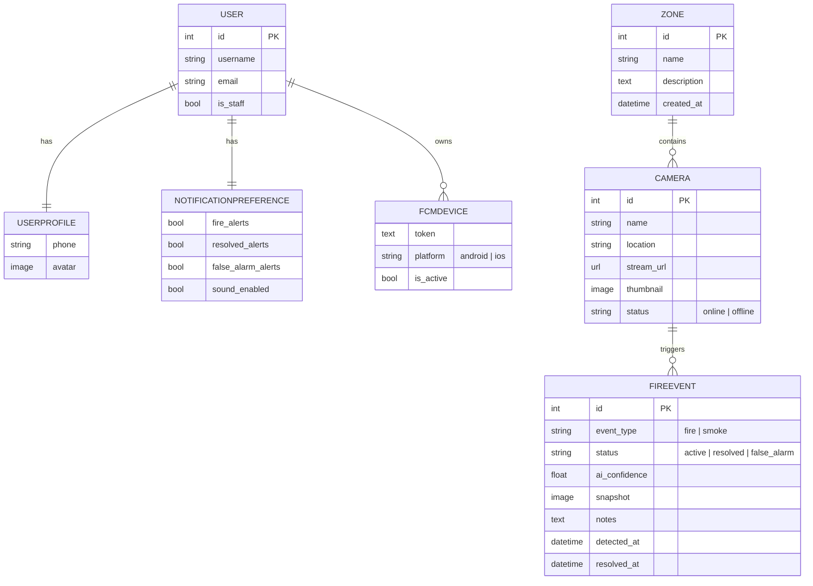
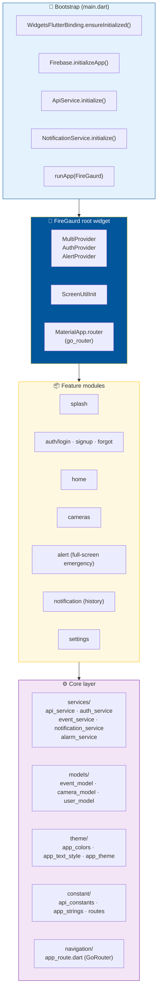
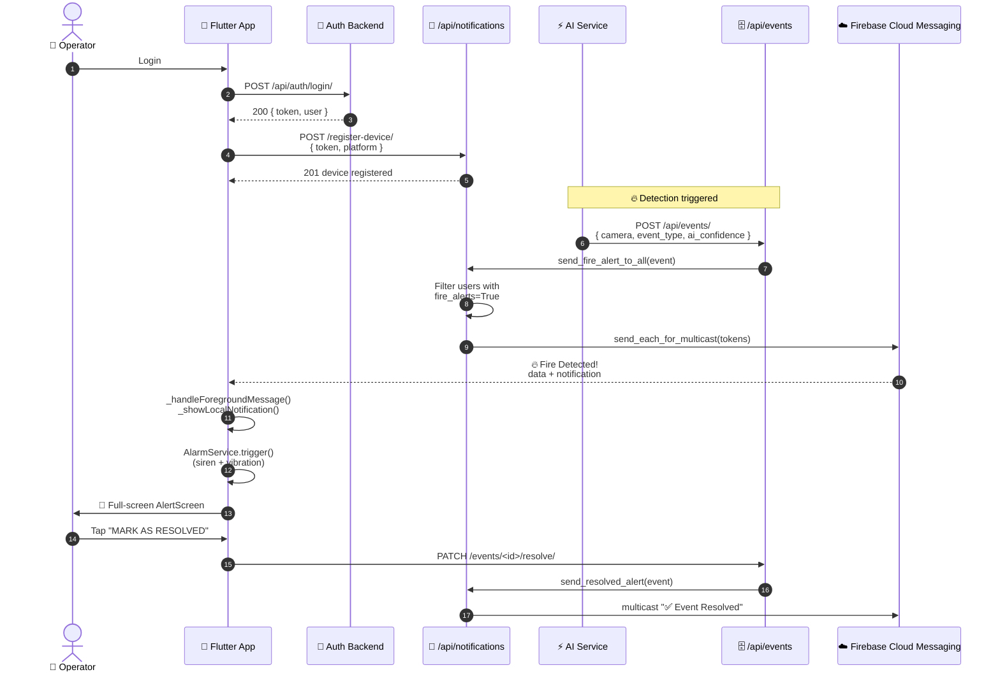
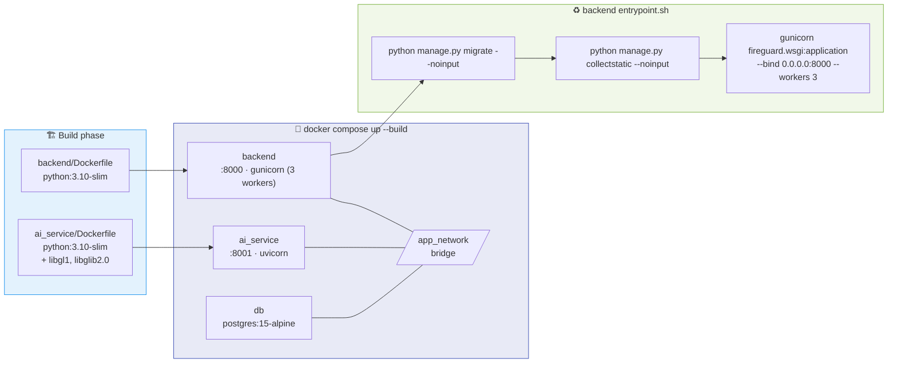
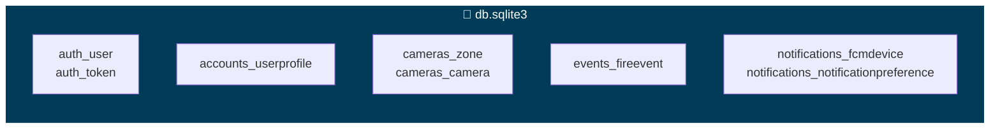
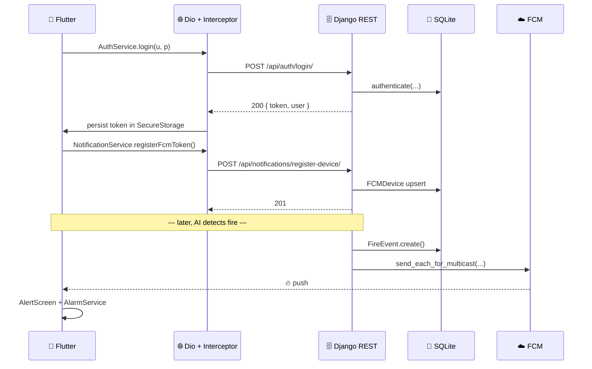

<div align="center">

<a href="#">
  
</a>

<br/>

<p>
  <em>An end-to-end fire & smoke detection ecosystem powered by <b>YOLOv8</b>, <b>FastAPI</b>, <b>Django REST</b>, and a beautiful <b>Flutter</b> mobile app — orchestrated with <b>Docker</b> and wired for real-time push alerts via <b>Firebase Cloud Messaging</b>.</em>
</p>

<br/>

<!-- ── Badges ───────────────────────────────────────────── -->
<p>
  
  
  
  
  
</p>
<p>
  
  
  
  
  
  
</p>
<p>
  
  
  
  
</p>

<br/>

<a href="#-quick-start">🚀 Quick Start</a> •
<a href="#-key-features">✨ Features</a> •
<a href="#-system-architecture">🏗️ Architecture</a> •
<a href="#-ai-pipeline">🧠 AI Pipeline</a> •
<a href="#-api-overview">📡 API</a> •
<a href="#-docker-deployment-flow">🐳 Docker</a> •
<a href="#-screenshots">📸 Screenshots</a>

</div>

<br/>

---

## 📖 Table of Contents

<details open>
<summary><b>Click to expand / collapse</b></summary>

1. [Project Overview](#-project-overview)
2. [Problem Statement](#-problem-statement)
3. [Solution Overview](#-solution-overview)
4. [Key Features](#-key-features)
5. [AI Fire / Smoke Detection Pipeline](#-ai-pipeline)
6. [System Architecture](#-system-architecture)
7. [Backend Architecture](#-backend-architecture)
8. [Frontend Architecture](#-frontend-architecture)
9. [Firebase Notification Flow](#-firebase-notification-flow)
10. [Docker Deployment Flow](#-docker-deployment-flow)
11. [SQLite Database](#-sqlite-database)
12. [API Overview](#-api-overview)
13. [Folder Structure](#-folder-structure)
14. [Quick Start](#-quick-start)
15. [Backend Setup](#-backend-setup)
16. [Frontend Setup](#-frontend-setup)
17. [Docker Setup](#-docker-setup)
18. [Environment Variables](#-environment-variables)
19. [Screenshots](#-screenshots)
20. [Demo](#-demo)
21. [Future Improvements](#-future-improvements)
22. [Contributors](#-contributors)
23. [License](#-license)

</details>

<br/>

---

## 🌟 Project Overview

**FireGuard** is a graduation-project-grade, **real-time fire and smoke detection platform** that combines a deep-learning inference microservice with a clean REST backend and a polished mobile experience.

It is engineered around three independent services that talk over HTTP:

<table>
<tr>
<td width="33%" align="center">

### 🧠 AI Service
**FastAPI · YOLOv8**

Real-time inference on uploaded frames, returning event type, confidence, and bounding boxes.

</td>
<td width="33%" align="center">

### 🗄️ Backend
**Django REST · SQLite**

Authentication, cameras, zones, fire events, notification preferences, and FCM dispatch.

</td>
<td width="33%" align="center">

### 📱 Mobile App
**Flutter · FCM**

Live system status, recent activity, camera grid, full-screen emergency alert with siren & vibration.

</td>
</tr>
</table>

> 🎓 Built as a graduation capstone — production-shaped code, clean separation of concerns, full Docker orchestration, and a real push-notification pipeline end-to-end.

<br/>

---

## ❗ Problem Statement

Fire and smoke incidents in homes, warehouses, and industrial facilities continue to cause devastating losses despite the wide availability of traditional smoke alarms. Conventional sensors share a few hard limitations:

| 🚫 Limitation | 📉 Real-World Impact |
| :--- | :--- |
| Slow chemical/optical sensors | Detect only after fire has already grown |
| No visual context | Operators don't know **what** triggered the alarm |
| No remote awareness | If you're not there, you don't know |
| Single-location alarm | No multi-camera / multi-zone awareness |
| High false-alarm cost | Cheap sensors over-trigger and get ignored |

A modern facility needs detection that is **early**, **visual**, **remote**, **multi-camera**, and **smart enough to suppress noise** while still being affordable to deploy.

<br/>

---

## 💡 Solution Overview

FireGuard reframes fire detection as a **computer-vision problem**:



A frame is captured, a YOLOv8 model classifies it as **fire / smoke / none**, the backend stores the event in SQLite, and a Firebase push instantly wakes every registered phone with a critical-priority alert that pops a full-screen emergency screen — with looping siren audio and patterned vibration.

<br/>

---

## ✨ Key Features

<table>
<tr>
<td width="50%" valign="top">

#### 🧠 AI-Powered Detection
- **YOLOv8** (Ultralytics) for fire & smoke
- Confidence threshold **0.5 (50%)**
- Bounding-box output for every detection
- Model **warm-up** on startup for low first-request latency
- Filters non-target classes automatically

#### 🗄️ Production-Grade Backend
- **Django 5.2 + DRF 3.17**
- **Token authentication** out of the box
- Full **Zone → Camera → FireEvent** data model
- Event status machine: `active` → `resolved` / `false_alarm`
- Stats endpoints for dashboards
- **Gunicorn** WSGI server, 3 workers
- Auto-`migrate` + `collectstatic` on container start

</td>
<td width="50%" valign="top">

#### 📱 Flutter Mobile App
- Clean **feature-first architecture**
- **Provider** state management
- **go_router** declarative navigation
- **Dio** HTTP with auth interceptor
- **flutter_secure_storage** for tokens
- `ScreenUtil` responsive sizing

#### 🔔 Real-Time Push Alerts
- **Firebase Cloud Messaging** (FCM) multicast
- Per-user **notification preferences**
- Critical-priority Android channel & iOS APNS
- **flutter_local_notifications** banners in-app
- Looping **siren audio** + **vibration pattern**
- Full-screen emergency screen, swipe-back blocked

</td>
</tr>
<tr>
<td width="50%" valign="top">

#### 🐳 Container-Native Deployment
- **Docker Compose** orchestration
- Health checks on every service
- Bridge network for inter-service DNS
- One-command stack: `docker compose up --build`

</td>
<td width="50%" valign="top">

#### 🧪 Developer-Friendly Tooling
- Standalone `webcam_client.py` for live testing
- `demo.py` terminal visualizer
- Mock `/status` and `/cameras` endpoints
- DRF browsable API + Django admin

</td>
</tr>
</table>

<br/>

---

## 🧠 AI Pipeline

The inference path lives entirely inside `ai_service/`. It is intentionally small and explicit — load the model once, warm it up, and serve.



#### ⚙️ Inference configuration (from `ai_service/model.py`)

| Setting | Value | Source |
| :--- | :--- | :--- |
| Model file | `model/best.pt` | `MODEL_PATH` |
| Target classes | `{"smoke", "fire"}` | `TARGET_CLASSES` |
| Confidence threshold | `0.5` | `CONF_THRESHOLD` |
| Input size | `640 × 640` | `INPUT_SIZE` |
| Notify threshold | `> 50.0` | `main.py: CONFIDENCE_THRESHOLD` |
| Device | CPU / GPU auto | Ultralytics default |
| Warm-up | Single dummy pass on load | `load_model()` |

#### 📦 What the service returns

```json
{
  "event_type": "fire",
  "confidence": 87.34,
  "detections": [
    {
      "label": "fire",
      "confidence": 87.34,
      "x1": 120.5,
      "y1": 80.2,
      "x2": 340.1,
      "y2": 260.9
    }
  ]
}
```

<br/>

---

## 🏗️ System Architecture

The full ecosystem is composed of **three loosely-coupled services** plus a Flutter client and lightweight Python testing tools.



#### 🔁 End-to-end request lifecycle

| # | Step | Component | Action |
| :-: | :--- | :--- | :--- |
| 1 | Frame captured | Edge client | Webcam or device camera grabs JPEG |
| 2 | Frame uploaded | AI Service | `POST /predict` (multipart) |
| 3 | Inference | YOLOv8 | Classify + filter to `{fire, smoke}` |
| 4 | Notify backend | AI Service → Django | `POST /api/events/` if conf > 50% |
| 5 | Persist | Django | `FireEvent` row written to SQLite |
| 6 | Push fan-out | Django → FCM | `send_each_for_multicast()` to opted-in devices |
| 7 | Mobile alert | Flutter | Full-screen alert + siren + vibration |
| 8 | Operator action | Flutter → Django | `PATCH /events/<id>/resolve/` or `/false-alarm/` |

<br/>

---

## 🗄️ Backend Architecture

The Django project is named **`fireguard`** and is split into four focused apps:



#### 📊 Domain model



#### 🔐 Authentication & permissions

| Concern | Implementation |
| :--- | :--- |
| Auth scheme | DRF **Token Authentication** (`rest_framework.authtoken`) |
| Token issuance | On register & login (`Token.objects.get_or_create`) |
| Token rotation | Re-issued on password change |
| CORS | `CORS_ALLOW_ALL_ORIGINS = True` |
| Camera/Zone write | `IsAdminOrReadOnly` custom permission |
| Event create | `AllowAny` (AI service posts unauthenticated) |
| All other endpoints | `IsAuthenticated` |

<br/>

---

## 📱 Frontend Architecture

The Flutter app `fire_gaurd` follows a **feature-first, clean-architecture-lite** layout under `frontend/lib/`.



#### 🧩 Mobile tech stack

| Concern | Package |
| :--- | :--- |
| State management | `provider ^6.1.5` |
| HTTP | `dio ^5.7.0` (with auth interceptor) |
| Routing | `go_router ^17.2.1` |
| Responsive sizing | `flutter_screenutil ^5.9.3` |
| Secure token storage | `flutter_secure_storage ^9.2.2` |
| Push notifications | `firebase_core ^3.13` + `firebase_messaging ^15.2` |
| Local notifications | `flutter_local_notifications ^18.0` |
| Alarm sound | `audioplayers ^6.4.0` |
| Vibration | `vibration ^3.1.0` |
| Date formatting | `intl ^0.20.2` |

#### 🎨 Brand color palette

| Token | Hex | Usage |
| :--- | :--- | :--- |
| `primary` | `#0F2A44` | App bars, primary CTAs |
| `danger` | `#FF3B30` | Fire alerts, destructive actions |
| `success` | `#16C784` | Resolved / online indicators |
| `warning` | `#FFC107` | Smoke / caution states |
| `background` | `#F5F7FA` | Screen backgrounds |
| `accent` | `#3B82F6` | Links / highlights |

<br/>

---

## 🔔 Firebase Notification Flow

End-to-end push pipeline driven by `notifications/fcm.py` on the server and `core/services/notification_service.dart` on the client.



#### 📨 What's in the payload

The backend ships **both** a `notification` block (so the OS draws a banner) **and** a structured `data` block that the app parses into an `EventModel`:

| Data key | Meaning |
| :--- | :--- |
| `type` | `fire_alert` · `smoke_alert` · `event_resolved` · `test` |
| `event_id` | DB id of the `FireEvent` |
| `camera_id` / `camera_name` / `location` / `zone` | Origin metadata |
| `event_type` | `fire` / `smoke` |
| `ai_confidence` | 0 – 100 |
| `detected_at` | ISO 8601 timestamp |

Android messages go through the **`alerts`** high-importance channel (red LED, vibration, sound, `fullScreenIntent`) and iOS uses `apns-priority: 10` + `interruptionLevel: critical`.

<br/>

---

## 🐳 Docker Deployment Flow

The repo ships a multi-service `docker-compose.yml` that builds and orchestrates the entire stack.



#### 🩺 Health checks

| Service | Probe | Interval | Retries |
| :--- | :--- | :--- | :--- |
| `ai_service` | `urllib.request.urlopen('http://localhost:8001/')` | 10s | 5 |
| `backend` | `urllib.request.urlopen('http://localhost:8000/')` | 10s | 5 |
| `db` | `pg_isready -U fireuser -d firedb` | 5s | 10 |

> ⚠️ **Note on the `db` service:** the application currently runs on **SQLite** (see [SQLite Database](#-sqlite-database)). The Postgres service in `docker-compose.yml` is provisioned and reachable for future migration, but Django itself reads/writes `db.sqlite3` inside the backend container. The backend `entrypoint.sh` explicitly comments: *"SQLite-only deployment: no DB host to wait for."*

<br/>

---

## 💾 SQLite Database

The Django backend persists everything to **SQLite** (`db.sqlite3`) — a perfect fit for a single-node graduation deployment and PythonAnywhere hosting.

```python
# backend/fireguard/settings.py
DATABASES = {
    'default': {
        'ENGINE': 'django.db.backends.sqlite3',
        'NAME': BASE_DIR / 'db.sqlite3',
    }
}
```

#### 🧱 What lives in SQLite



#### 🤔 Why SQLite for this deployment?

| ✅ Pro | 💬 Why it matters here |
| :--- | :--- |
| Zero setup | No external DB server to provision |
| Single file | Easy to back up, ship, and inspect |
| Plenty fast | This workload is event-write & metadata-read, not high-concurrency OLTP |
| Plays nicely with PythonAnywhere | Free-tier hosting friendly |
| Migration-ready | Switching to PostgreSQL = change `DATABASES` and re-run `migrate` |

> 🔄 The `events`, `cameras`, `accounts`, and `notifications` migration files are already authored and committed, so a fresh deployment simply runs `python manage.py migrate` (this is done automatically by `entrypoint.sh`).

<br/>

---

## 📡 API Overview

All Django endpoints live under `/api/` and require an `Authorization: Token <key>` header, except where noted.

<details>
<summary><b>🔐 Authentication — <code>/api/auth/</code></b></summary>

| Method | Path | Auth | Purpose |
| :--- | :--- | :--- | :--- |
| `POST` | `/register/` | Public | Create account + issue token |
| `POST` | `/login/` | Public | Exchange credentials for token |
| `POST` | `/logout/` | Token | Invalidate current token |
| `GET` | `/profile/` | Token | Read profile + user info |
| `PATCH` | `/profile/` | Token | Update first/last name, email, phone, avatar |
| `POST` | `/change-password/` | Token | Rotate password & re-issue token |

</details>

<details>
<summary><b>🎥 Cameras & Zones — <code>/api/cameras/</code></b></summary>

| Method | Path | Auth | Purpose |
| :--- | :--- | :--- | :--- |
| `GET` | `/stats/` | Read-only | `total_units`, `online_now`, `offline` |
| `GET / POST` | `/zones/` | Admin write | List / create zones |
| `GET / PUT / PATCH / DELETE` | `/zones/<id>/` | Admin write | Zone detail |
| `GET / POST` | `/cameras/` | Admin write | List / create cameras (filter `zone`, `status`) |
| `GET / PUT / PATCH / DELETE` | `/cameras/<id>/` | Admin write | Camera detail |
| `PATCH` | `/cameras/<id>/status/` | Admin | Toggle `online` ⇄ `offline` |

</details>

<details>
<summary><b>🔥 Fire Events — <code>/api/events/</code></b></summary>

| Method | Path | Auth | Purpose |
| :--- | :--- | :--- | :--- |
| `GET` | `/` | Token | List events (filters: `status`, `camera`, `zone`, `type`) |
| `POST` | `/` | **Public** | Create event (used by AI service) |
| `GET / PATCH` | `/<id>/` | Token | Detail / edit notes |
| `PATCH` | `/<id>/resolve/` | Token | Mark resolved + fire **resolved** push |
| `PATCH` | `/<id>/false-alarm/` | Token | Mark as false alarm |
| `GET` | `/active/` | Token | Most recent **active** event (single) |
| `GET` | `/stats/` | Token | Counters: total · fire · smoke · active · resolved · false_alarm |

</details>

<details>
<summary><b>🔔 Notifications — <code>/api/notifications/</code></b></summary>

| Method | Path | Auth | Purpose |
| :--- | :--- | :--- | :--- |
| `POST` | `/register-device/` | Token | Upsert an FCM device token |
| `DELETE` | `/unregister-device/` | Token | Remove FCM device token |
| `GET / PATCH` | `/preferences/` | Token | Read / update `fire_alerts`, `resolved_alerts`, `false_alarm_alerts`, `sound_enabled` |
| `POST` | `/test-push/` | Token | Send a test push to a token (dev helper) |

</details>

<details>
<summary><b>⚡ AI Service — port 8001</b></summary>

| Method | Path | Purpose |
| :--- | :--- | :--- |
| `GET` | `/` | Health check — `{"message": "ok"}` |
| `GET` | `/status` | Mocked `total_cameras` / `online` summary |
| `GET` | `/cameras` | Mocked camera list |
| `POST` | `/predict` | Multipart image upload → `{event_type, confidence, detections[]}` |

</details>

#### 🔁 API call flow (mobile → backend → push)



<br/>

---

## 📁 Folder Structure

<details open>
<summary><b>Click to expand the full tree</b></summary>

```text
Fire Detection/
│
├── 📂 ai_service/                # ⚡ FastAPI inference microservice
│   ├── Dockerfile                # python:3.10-slim + libgl1 / libglib2.0
│   ├── requirements.txt          # fastapi · uvicorn · ultralytics · opencv-headless
│   ├── best.pt                   # 🧠 trained YOLOv8 weights
│   ├── main.py                   # FastAPI app · /predict · /status · /cameras
│   ├── inference.py              # FireDetector class · notify_backend()
│   └── model.py                  # YOLO loader · run_inference() · TARGET_CLASSES
│
├── 📂 backend/                   # 🗄️ Django REST API
│   ├── Dockerfile                # python:3.10-slim + gunicorn
│   ├── entrypoint.sh             # migrate · collectstatic · gunicorn (3 workers)
│   ├── manage.py
│   ├── requirements.txt          # Django 5.2 · DRF · firebase_admin · gunicorn
│   │
│   ├── fireguard/                # 🛠️ Django project package
│   │   ├── settings.py           # SQLite · DRF · CORS · Firebase paths
│   │   ├── urls.py               # /admin · /api/auth · /api/cameras · /api/events · /api/notifications
│   │   ├── firebase.py           # initialize_firebase() (idempotent)
│   │   ├── wsgi.py / asgi.py
│   │
│   ├── accounts/                 # 👤 Users & profiles
│   │   ├── models.py             # UserProfile + auto-create signals
│   │   ├── views.py              # Register · Login · Logout · Profile · ChangePassword
│   │   ├── serializers.py
│   │   └── urls.py
│   │
│   ├── cameras/                  # 🎥 Zones & cameras
│   │   ├── models.py             # Zone · Camera (online|offline)
│   │   ├── views.py              # CRUD + stats + status toggle
│   │   ├── serializers.py
│   │   └── urls.py
│   │
│   ├── events/                   # 🔥 Fire events
│   │   ├── models.py             # FireEvent (fire|smoke · active|resolved|false_alarm)
│   │   ├── views.py              # CRUD + resolve + false-alarm + stats + active
│   │   ├── serializers.py
│   │   ├── admin.py
│   │   └── urls.py
│   │
│   └── notifications/            # 🔔 FCM dispatch
│       ├── models.py             # FCMDevice · NotificationPreference
│       ├── fcm.py                # send_fire_alert_to_all · send_resolved_alert · send_test_push
│       ├── views.py              # Register/Unregister device · Preferences · TestPush
│       ├── apps.py               # AppConfig.ready() → initialize_firebase()
│       ├── serializers.py
│       └── urls.py
│
├── 📂 frontend/                  # 📱 Flutter mobile app (fire_gaurd)
│   ├── pubspec.yaml              # firebase_messaging · dio · go_router · provider
│   └── lib/
│       ├── main.dart             # Firebase + Dio + NotificationService init
│       ├── fire_gaurd.dart       # Root MultiProvider + MaterialApp.router
│       │
│       ├── core/
│       │   ├── constant/         # api_constants · app_strings · routes
│       │   ├── models/           # event_model · camera_model · user_model
│       │   ├── navigation/       # app_route.dart (GoRouter)
│       │   ├── services/         # api_service · auth_service · event_service
│       │   │                     # notification_service · alarm_service · endpoints
│       │   ├── theme/            # app_colors · app_text_style · app_theme
│       │   └── widgets/          # app_button · spacing_widget · …
│       │
│       └── feature/
│           ├── splash/           # SplashScreen · provider
│           ├── auth/             # login · signup · forgot_password
│           ├── home/             # HomeScreen · status card · stats · activity
│           ├── cameras/          # Grid · add · delete · cards
│           ├── alert/            # 🚨 Full-screen emergency screen
│           ├── notification/     # Notification history + tabs
│           └── settings/         # SettingsScreen
│
├── 🐳 docker-compose.yml         # ai_service · backend · db · app_network
│
├── 🧪 webcam_client.py           # OpenCV → POST /predict every 2s
├── 🧪 demo.py                    # Terminal-style live demo
├── 🧪 main.py / inference.py / model.py   # Root copies for local dev
│
└── 📖 README.md                  # This file
```

</details>

<br/>

---

## 🚀 Quick Start

#### ✅ Prerequisites

| Tool | Version | Required for |
| :--- | :--- | :--- |
| Docker & Docker Compose | latest | One-shot full-stack run |
| Python | 3.10+ | Local backend / AI dev, webcam client |
| Flutter SDK | 3.9+ | Mobile app |
| YOLOv8 weights | `best.pt` | Inference |
| Firebase project | optional | Push notifications |

#### ⏱️ 60-second start

```bash
# 1 — clone
git clone https://github.com/mostafaabdoelgohary2003AI/fireguard-graduation-project.git
cd "Fire Detection"

# 2 — drop your trained model in
#    expected at:  ai_service/model/best.pt
mkdir -p ai_service/model
cp /path/to/best.pt ai_service/model/best.pt

# 3 — launch the whole stack
docker compose up --build

# 4 — try it
curl http://localhost:8001/                       # AI service health
curl http://localhost:8000/admin/                 # Django admin
python webcam_client.py                           # live webcam feed → AI
```

<br/>

---

## 🛠️ Backend Setup

> Run locally without Docker — perfect for development, debugging, and admin work.

```bash
cd backend
python -m venv .venv
source .venv/bin/activate              # Windows: .venv\Scripts\activate
pip install -r requirements.txt

# 1 — apply migrations (SQLite file is auto-created)
python manage.py migrate

# 2 — create a superuser for /admin
python manage.py createsuperuser

# 3 — (optional) drop Firebase credentials in
#     backend/firebase_credentials.json
#     If missing, the app still runs but push delivery is skipped.

# 4 — collect static files
python manage.py collectstatic --noinput

# 5a — dev server
python manage.py runserver 0.0.0.0:8000

# 5b — production server (same as Docker entrypoint)
gunicorn fireguard.wsgi:application --bind 0.0.0.0:8000 --workers 3
```

> 🔑 The backend includes the **Django admin** at `/admin/` — use it to seed `Zone` and `Camera` rows before sending events from the AI service.

<br/>

---

## 📱 Frontend Setup

```bash
cd frontend
flutter pub get

# Point the app at your backend (default: PythonAnywhere demo)
flutter run \
  --dart-define=BACKEND_URL=http://10.0.2.2:8000   # Android emulator → host
# or
flutter run \
  --dart-define=BACKEND_URL=http://localhost:8000  # iOS simulator
```

#### 🔥 Firebase setup (push notifications)

The app already depends on `firebase_core` and `firebase_messaging`. To enable push delivery you need to drop **your own** Firebase config into the mobile project:

| Platform | File | Location |
| :--- | :--- | :--- |
| Android | `google-services.json` | `frontend/android/app/` |
| iOS | `GoogleService-Info.plist` | `frontend/ios/Runner/` |

…and place the matching **service-account JSON** for the **backend** at:

```
backend/firebase_credentials.json
```

The backend reads this path from `FIREBASE_CREDENTIALS_PATH` (env-overridable). If the file is missing, `initialize_firebase()` logs a warning and the rest of the app keeps working — push simply won't fire.

#### 🎵 Alarm asset

Drop a royalty-free siren MP3 at:

```
frontend/assets/sounds/alarm.mp3
```

If the file is missing the `AlarmService` silently falls back to vibration only.

<br/>

---

## 🐳 Docker Setup

```bash
# Build & run everything
docker compose up --build

# Tail logs
docker compose logs -f ai_service
docker compose logs -f backend

# Stop
docker compose down

# Reset (deletes the postgres volume)
docker compose down -v
```

The compose file wires three services on a `bridge` network called `app_network`:

| Service | Port | Image / Build |
| :--- | :--- | :--- |
| `ai_service` | `8001` | Built from `./ai_service/Dockerfile` |
| `backend` | `8000` | Built from `./backend/Dockerfile` |
| `db` | (internal) | `postgres:15-alpine` (provisioned, not yet active — see [SQLite note](#-sqlite-database)) |

Both Python services run with `restart: always` and **service-level health checks**, so a crash inside the AI worker won't take down Django, and vice versa.

<br/>

---

## 🔧 Environment Variables

#### 🗄️ Backend

| Variable | Default | Purpose |
| :--- | :--- | :--- |
| `SECRET_KEY` | `unsafe-dev-key-change-me` | Django secret key |
| `ALLOWED_HOSTS` | `bodareda0001.pythonanywhere.com,localhost,127.0.0.1,0.0.0.0` | Comma-separated host whitelist |
| `FIREBASE_CREDENTIALS_PATH` | `backend/firebase_credentials.json` | Firebase service-account JSON path |
| `DB_HOST` / `DB_PORT` / `DB_NAME` / `DB_USER` / `DB_PASSWORD` | from compose | Reserved for future Postgres migration |
| `AI_SERVICE_URL` | `http://ai_service:8001` | Internal URL for the AI service |

`.env` files in `backend/` are loaded automatically via `python-dotenv`.

#### ⚡ AI service

| Variable | Default | Purpose |
| :--- | :--- | :--- |
| `DJANGO_BACKEND_URL` | `https://bodareda0001.pythonanywhere.com` | Where to POST detected events |

#### 📱 Flutter

| Define | Default | Purpose |
| :--- | :--- | :--- |
| `BACKEND_URL` | `https://bodareda0001.pythonanywhere.com` | REST base URL — pass via `--dart-define=BACKEND_URL=…` |

<br/>

---

## 📸 Screenshots

> Drop your captured screens into `frontend/screenshots/` and they'll render here. Below are placeholder slots that match the actual implemented screens.

<table>
<tr>
<th width="25%">🌅 Splash</th>
<th width="25%">🔐 Login</th>
<th width="25%">🏠 Home</th>
<th width="25%">🎥 Cameras</th>
</tr>
<tr>
<td></td>
<td></td>
<td></td>
<td></td>
</tr>
<tr>
<th>🚨 Alert (Fire)</th>
<th>💨 Alert (Smoke)</th>
<th>🔔 Notifications</th>
<th>⚙️ Settings</th>
</tr>
<tr>
<td></td>
<td></td>
<td></td>
<td></td>
</tr>
</table>

<br/>

---

## 🎬 Demo

> Drop a recorded screen capture at `docs/demo.gif` and a hosted MP4 at `docs/demo.mp4`.

<div align="center">


<br/><br/>

[](#)

</div>

#### 🧪 Reproduce the demo locally

```bash
# Terminal 1 — full stack
docker compose up --build

# Terminal 2 — stream your webcam into the AI service
python webcam_client.py
# Expect:
#   event_type=fire   confidence=87.34   → 🔥 FIRE DETECTED
#   event_type=smoke  confidence=72.10   → 🔥 FIRE DETECTED
#   event_type=none   confidence=0.0     → No fire

# Terminal 3 — pretty-printed ASCII demo
python demo.py
```

> 💡 Tap **"SIMULATE ALERT (Demo)"** at the bottom of the Flutter Home screen to trigger the full alert UX (siren + vibration + full-screen alert) without needing a real fire.

<br/>

---

## 🔮 Future Improvements

<table>
<tr>
<td width="50%" valign="top">

#### 🧠 Model & Inference
- 📊 Larger / more diverse fire & smoke dataset
- 🌫️ Dedicated smoke-only fine-tune to suppress steam false positives
- ⚡ Quantized `int8` model for edge devices (Jetson / Coral)
- 🎯 Per-camera confidence thresholds & cooldowns
- 🎥 Direct RTSP stream consumption inside the AI service

#### 🗄️ Backend
- 🐘 Switch to **PostgreSQL** for multi-worker safety (compose already provisioned)
- 🧾 Snapshot upload from the AI service (currently the field exists but isn't filled)
- 📈 Time-series aggregations & dashboards
- ⛓️ Async tasks (Celery + Redis) for FCM fan-out

</td>
<td width="50%" valign="top">

#### 📱 Mobile
- 🎞️ Live thumbnail / RTSP preview inside `CameraCard`
- 🌙 Dark theme + dynamic color
- 🗺️ Map view of zones & cameras
- 👥 Multi-role accounts (operator vs admin)
- 🔄 Offline event queue with sync

#### 🔐 Ops & Security
- 🔑 Per-environment `SECRET_KEY` & rotated tokens
- 🌐 HTTPS termination + restricted CORS
- 📜 Structured logging + centralized log shipping
- ✅ CI pipeline (lint · tests · build · push)
- 🩺 Prometheus / Grafana metrics

</td>
</tr>
</table>

<br/>

---

## 👥 Contributors

<div align="center">

<table>
<tr>
<td align="center" width="50%">

<a href="https://github.com/mostafaabdoelgohary2003AI">
  
</a>

<br/>

**Mostafa Abdo Fathy Abdo El-Gohary**

`AI / Backend / Mobile Lead`

<a href="https://github.com/mostafaabdoelgohary2003AI">
  
</a>

</td>
<td align="center" width="50%">

<a href="https://github.com/Abdelrahman000111">
  
</a>

<br/>

**Abdelrahman Reda**

`Backend / Notifications`

<a href="https://github.com/Abdelrahman000111">
  
</a>

</td>
</tr>
</table>

</div>

<br/>

---

## 📜 License

<div align="center">


</div>

This repository is part of a **graduation capstone project** and is released for academic, educational, and portfolio purposes. All trademarks (Django, FastAPI, Flutter, Firebase, Ultralytics, Docker, SQLite) belong to their respective owners.

Please contact the maintainers before any commercial reuse.

<br/>

---

<div align="center">

<sub>Built with 🔥 by the FireGuard team — keeping people safer, one frame at a time.</sub>

<br/>


</div>
