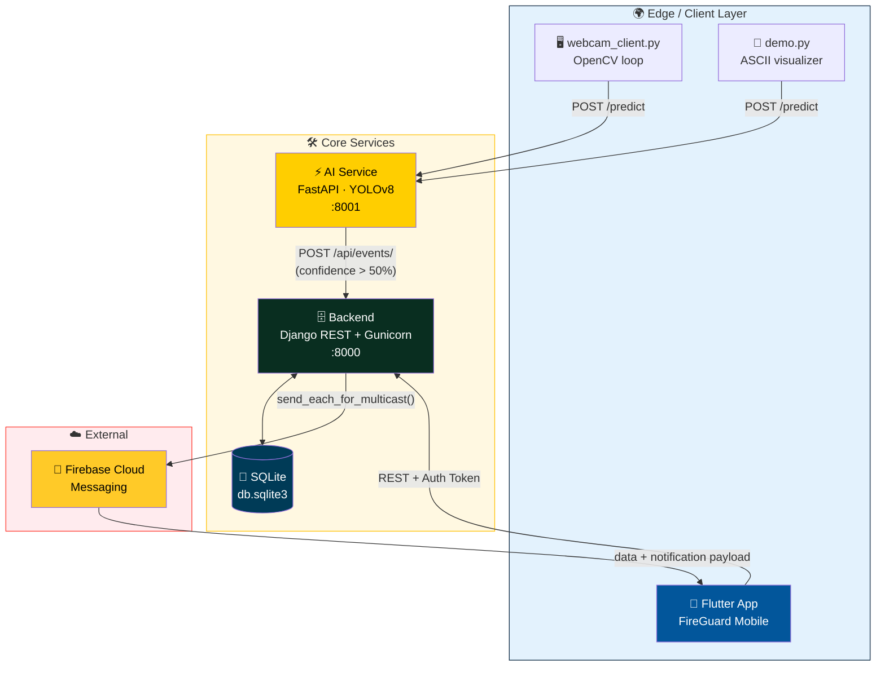
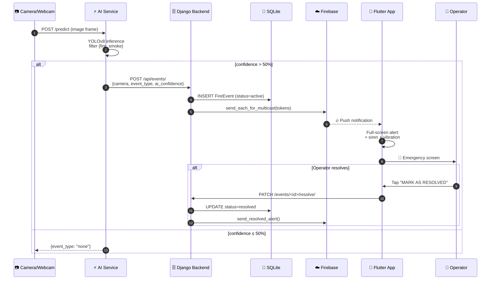
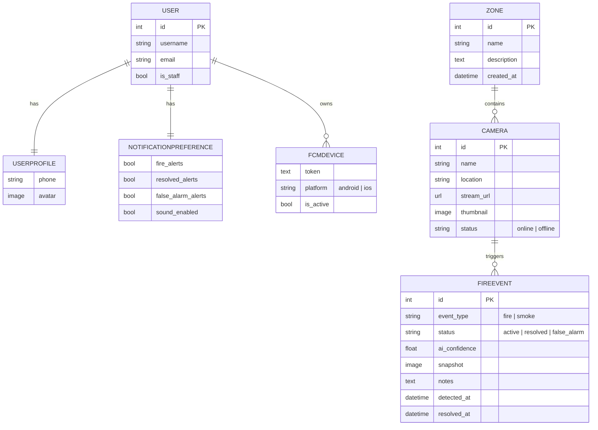
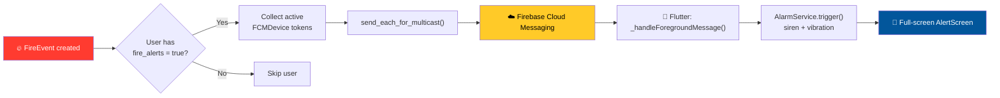
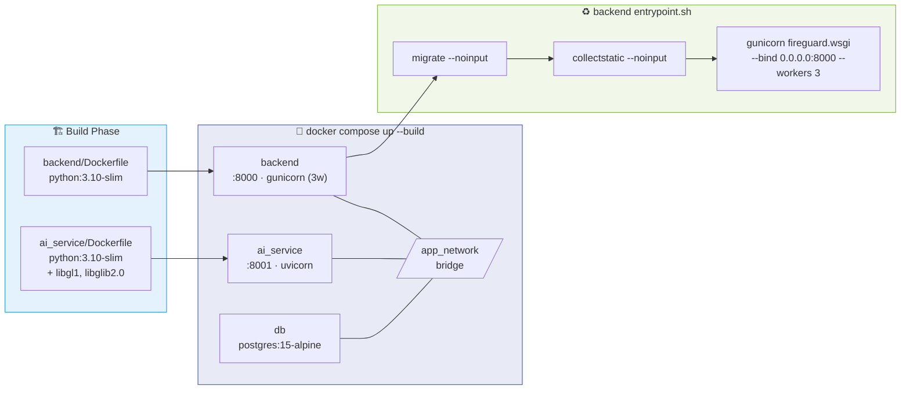

# FireGuard — System Architecture

> Comprehensive architecture reference for the FireGuard real-time fire & smoke detection platform.  
> This document is designed for inclusion in the graduation report/book.

---

## Table of Contents

1. [System Overview](#1-system-overview)
2. [Component Architecture](#2-component-architecture)
3. [Data Flow](#3-data-flow)
4. [Technology Stack](#4-technology-stack)
5. [Database Schema](#5-database-schema)
6. [Notification Pipeline](#6-notification-pipeline)
7. [Deployment Architecture](#7-deployment-architecture)

---

## 1. System Overview

FireGuard is a **microservice-based platform** composed of three independent services that communicate over HTTP:

### Design Principles

| Principle | Implementation |
| :--- | :--- |
| **Separation of concerns** | Each service owns a single domain (AI inference, business logic, mobile UX) |
| **Loose coupling** | Services communicate via HTTP REST — no shared state or databases |
| **Independent deployability** | Each service has its own Dockerfile and can be deployed/scaled independently |
| **Graceful degradation** | If Firebase credentials are missing, the app still works minus push notifications |

---

## 2. Component Architecture

### 2.1 AI Service (FastAPI + YOLOv8)

| Attribute | Value |
| :--- | :--- |
| **Framework** | FastAPI 0.110 |
| **Server** | Uvicorn (ASGI) |
| **Model** | YOLOv8 (Ultralytics) — custom trained |
| **Port** | 8001 |
| **Input** | Multipart image upload (JPEG/PNG) |
| **Output** | JSON: `{event_type, confidence, detections[]}` |

**Responsibilities:**
- Load and warm up the YOLOv8 model on startup
- Accept image frames via `POST /predict`
- Run inference, filter to target classes (`fire`, `smoke`)
- Auto-notify the Django backend when confidence > 50%
- Provide health check and mock camera endpoints

**Key files:** `ai_service/main.py`, `ai_service/inference.py`, `ai_service/model.py`

---

### 2.2 Backend (Django REST Framework)

| Attribute | Value |
| :--- | :--- |
| **Framework** | Django 5.2 + DRF 3.17 |
| **Server** | Gunicorn (3 workers) |
| **Database** | SQLite3 |
| **Port** | 8000 |
| **Auth** | DRF Token Authentication |

**Django apps:**

| App | Domain | Key Models |
| :--- | :--- | :--- |
| `accounts` | User management | `UserProfile` |
| `cameras` | Infrastructure registry | `Zone`, `Camera` |
| `events` | Detection lifecycle | `FireEvent` |
| `notifications` | Push delivery | `FCMDevice`, `NotificationPreference` |

**Key files:** `backend/fireguard/settings.py`, `backend/fireguard/urls.py`, `backend/fireguard/firebase.py`

---

### 2.3 Mobile App (Flutter)

| Attribute | Value |
| :--- | :--- |
| **Framework** | Flutter 3.9+ / Dart ^3.9 |
| **State management** | Provider ^6.1.5 |
| **HTTP client** | Dio ^5.7.0 (with auth interceptor) |
| **Routing** | go_router ^17.2.1 |
| **Push** | firebase_core + firebase_messaging |

**Architecture:** Feature-first, clean-architecture-lite layout under `frontend/lib/`.

**Feature modules:** `splash`, `auth`, `home`, `cameras`, `alert`, `notification`, `settings`

---

## 3. Data Flow

### 3.1 End-to-End Detection Lifecycle

### 3.2 Request Lifecycle Table

| # | Step | Component | Action |
| :-: | :--- | :--- | :--- |
| 1 | Frame captured | Edge client | Webcam or device camera grabs JPEG |
| 2 | Frame uploaded | AI Service | `POST /predict` (multipart) |
| 3 | Inference | YOLOv8 | Classify + filter to `{fire, smoke}` |
| 4 | Notify backend | AI Service → Django | `POST /api/events/` if conf > 50% |
| 5 | Persist | Django | `FireEvent` row written to SQLite |
| 6 | Push fan-out | Django → FCM | `send_each_for_multicast()` to opted-in devices |
| 7 | Mobile alert | Flutter | Full-screen alert + siren + vibration |
| 8 | Operator action | Flutter → Django | `PATCH /events/<id>/resolve/` or `/false-alarm/` |

---

## 4. Technology Stack

### 4.1 Backend Technologies

| Technology | Version | Purpose |
| :--- | :--- | :--- |
| Python | 3.10+ | Runtime |
| Django | 5.2 | Web framework |
| Django REST Framework | 3.17 | REST API |
| Gunicorn | 21.2 | WSGI production server |
| SQLite3 | Built-in | Database |
| firebase-admin | Latest | FCM push dispatch |
| django-cors-headers | Latest | CORS handling |
| python-dotenv | Latest | Environment variable loading |

### 4.2 AI Service Technologies

| Technology | Version | Purpose |
| :--- | :--- | :--- |
| FastAPI | 0.110 | API framework |
| Uvicorn | Latest | ASGI server |
| Ultralytics (YOLOv8) | Latest | Object detection model |
| OpenCV (headless) | Latest | Image decoding/processing |
| NumPy | Latest | Array operations |

### 4.3 Mobile Technologies

| Technology | Version | Purpose |
| :--- | :--- | :--- |
| Flutter | 3.9+ | Cross-platform framework |
| Dart | ^3.9 | Programming language |
| Provider | ^6.1.5 | State management |
| Dio | ^5.7.0 | HTTP client |
| go_router | ^17.2.1 | Navigation |
| firebase_core | ^3.13 | Firebase initialization |
| firebase_messaging | ^15.2 | Push notifications |
| flutter_local_notifications | ^18.0 | Local notification banners |
| audioplayers | ^6.4.0 | Alarm siren audio |
| vibration | ^3.1.0 | Device vibration |
| flutter_screenutil | ^5.9.3 | Responsive sizing |
| flutter_secure_storage | ^9.2.2 | Token persistence |

### 4.4 DevOps

| Technology | Purpose |
| :--- | :--- |
| Docker + Docker Compose | Container orchestration |
| PythonAnywhere | Free-tier cloud hosting |
| Firebase Cloud Messaging | Push notification delivery |

---

## 5. Database Schema

---

## 6. Notification Pipeline

### Payload structure

| Block | Key | Example |
| :--- | :--- | :--- |
| `notification` | `title` | `🔥 Fire Detected!` |
| `notification` | `body` | `Camera: Main Entrance — Zone: Warehouse A` |
| `data` | `type` | `fire_alert` / `smoke_alert` / `event_resolved` |
| `data` | `event_id` | `42` |
| `data` | `camera_name` | `Main Entrance` |
| `data` | `ai_confidence` | `87.34` |
| `data` | `detected_at` | `2026-05-14T19:32:00Z` |

### Platform-specific configuration

| Platform | Channel/Priority | Behavior |
| :--- | :--- | :--- |
| Android | `alerts` channel, high importance | Red LED, vibration, sound, `fullScreenIntent` |
| iOS | `apns-priority: 10`, `interruptionLevel: critical` | Bypasses Do Not Disturb |

---

## 7. Deployment Architecture

### Health checks

| Service | Probe | Interval | Retries |
| :--- | :--- | :--- | :--- |
| `ai_service` | `urllib.request.urlopen('http://localhost:8001/')` | 10s | 5 |
| `backend` | `urllib.request.urlopen('http://localhost:8000/')` | 10s | 5 |
| `db` | `pg_isready -U fireuser -d firedb` | 5s | 10 |

> **Note:** The application currently runs on **SQLite**. The Postgres service in `docker-compose.yml` is provisioned for future migration, but Django reads/writes `db.sqlite3` inside the backend container.

---

*This document is part of the FireGuard graduation project — May 2026.*
